# Quant Toss

**국내·미국 주식의 확률적 수익률 예측과 비용을 반영한 모의매매 연구.**

Patch Transformer와 learned mixture experts로 1·5·20 거래일의 수익률 분포를 예측합니다. 시간 순서 분리, 미래 라벨 purge, embargo, train-only 정규화, 독립적인 interval calibration, 기본 모델 비교, expanding-window walk-forward 평가를 제공합니다. 토스증권 **공식 Open API**의 일봉 시세 조회 adapter를 포함합니다.

**현재 상태:** CPU에서 합성 데이터의 실제 학습·보정·백테스트·추론과 단위 테스트를 실행했습니다. 실제 주가 성능, 실계좌 연결, 수익성은 아직 검증하지 않았습니다. 이 프로젝트는 수익을 보장하거나 특정 종목 매수를 추천하지 않습니다. 주문 전송 기능은 포함하지 않으며, 시세 API 연결에는 사용자가 직접 설정한 로컬 access token이 필요합니다.

Probabilistic stock forecasting with purged chronological validation, noncrossing quantiles, cost-aware paper backtesting, and an official read-only Toss Invest adapter. Synthetic execution is engineering evidence, not a historical profit claim.

## 모델과 연구 질문

> 복잡한 시계열 모델이 간단한 linear 모델·과거 수익률 분포·현금 보유보다, 미래 구간에서 예측과 비용 차감 후 투자 성과를 개선하는가?

```mermaid
flowchart LR
    A[완료된 OHLCV 일봉] --> B[과거 정보만 사용하는 features]
    B --> C[Train-only scaling]
    C --> D[Feature gating]
    D --> E[Patch Transformer]
    E --> F[Mixture of quantile experts]
    F --> G[1 / 5 / 20 거래일 q10·median·q90]
    G --> H[독립적인 interval calibration]
    H --> I[거래 비용·불확실성 기반 long/cash 정책]
    I --> J[다음 시가 진입 / 당일 종가 청산 모의매매]
    K[Toss 공식 일봉 API] --> A
```



예측 target은 `close[t+h] / open[t+1] - 1`입니다. 관측 종료 시점 t의 다음 거래일 시가를 진입 기준으로 삼습니다. 시가가 아직 알려지지 않았으므로 확정적인 미래 원화·달러 가격 대신 **다음 시가 대비 수익률의 범위**를 출력합니다. 기본 거래 정책은 1일 horizon만 사용하며, 5·20일 head는 예측 평가용입니다.

입력은 수익률, overnight gap, intraday return, high/low range, 거래량 변화, 5·20일 momentum, 20일 변동성, 종가의 일중 위치입니다. 모든 값은 해당 완료 일봉까지의 정보로 계산됩니다. Mixture weights는 학습된 가중치이며 상승장/하락장 등 검증된 경제적 국면 라벨이 아닙니다. Feature weights도 인과적 설명이 아닙니다.

이 설계는 기존 attention·patching·quantile regression 기법을 조합한 연구 구현입니다. 새로운 논문 기법을 발명했거나 SOTA를 달성했다는 주장을 하지 않습니다.

## 설치와 바로 실행

이 저장소 루트에서 Python 3.10+로 실행합니다. CPU만으로 데모가 동작합니다.

```bash
python3 -m venv .venv
source .venv/bin/activate
python -m pip install -e .
python -m unittest discover -s tests -v
python -m quant_toss.demo --output artifacts/first_demo --open
```

데모는 실제 가격이 아닌 1,100개 합성 거래일을 생성하고 linear/transformer를 각각 2 epochs 학습합니다. checkpoint, 예측 보고서, 비용 차감 모의매매 ledger와 최종 forecast를 저장합니다. 같은 명령을 다시 실행할 때는 새 output 이름을 사용하세요.

`--open`은 완료 후 브라우저에서 **결과 보고서**를 엽니다. 가격 흐름, 학습 오차, 1·5·20 거래일 예측 범위, 모델 비교와 모의매매 결과를 표시합니다. 실시간 시세 화면이나 주문 화면은 아닙니다. 브라우저를 열 수 없는 환경에서는 `--open`을 빼고 실행한 뒤 생성된 `report.html`을 직접 여세요.

이미 데모를 실행했다면 재학습 없이 결과를 볼 수 있습니다:

```bash
python -m quant_toss.report --input artifacts/first_demo --open
```

학습 완료 후 터미널이 명령 입력 상태로 돌아가는 것은 정상입니다. 기존 출력 폴더로 다시 학습하면 파일 보호를 위해 중단하고 새 폴더 이름을 안내합니다.

```text
artifacts/first_demo/
  synthetic.csv
  linear/model.pt
  linear/report.json
  transformer/model.pt
  transformer/report.json
  transformer/ledger.json
  forecast.json
  report.html
```

합성 데모에서는 보수적인 거래 조건을 충족하지 않아 두 모델 모두 거래 0회, 모의 수익률 0%가 나왔습니다. 이것은 수익성 검증이 아닙니다. 정책을 바꿔 높은 숫자를 만들기보다 실제 OOS 데이터로 전략 가설을 검증해야 합니다.

## 실제 주가 CSV로 학습

한 CSV에는 **한 종목·한 통화**의 완료된 일봉만 넣습니다. 날짜는 시장의 현지 거래일, 오름차순, 중복 없이 기록합니다. 모든 OHLC는 동일한 corporate-action adjustment 기준이어야 합니다.

```csv
date,open,high,low,close,volume
2024-01-02,100,103,99,102,1000000
2024-01-03,102,104,101,103,1100000
```

기본 lookback=64와 20일 label purge를 사용하므로 충분한 일봉 이력이 필요합니다. 짧은 데이터에서 일부 split이 8개 미만이 되면 실행을 거절합니다. 이 최소값은 통계적으로 충분한 표본이라는 의미가 아닙니다.

```bash
# US 데이터 예시. AAPL이라는 이름은 실행 형식 예시이며 종목 추천이 아닙니다.
quant-toss research --csv data/AAPL.csv --symbol AAPL --currency USD \
  --output artifacts/AAPL_transformer --epochs 30

quant-toss research --csv data/AAPL.csv --symbol AAPL --currency USD \
  --output artifacts/AAPL_linear --architecture linear --epochs 30

# KR 종목도 같은 코드로 실행합니다. 두 통화의 잔고나 성과를 합치지 않습니다.
quant-toss research --csv data/005930.csv --symbol 005930 --currency KRW \
  --output artifacts/KR_transformer --epochs 30 \
  --cost-bps 10 --sell-tax-bps 0

quant-toss walk-forward --csv data/AAPL.csv --symbol AAPL --currency USD \
  --output artifacts/walk_forward --epochs 30 --folds 3

quant-toss predict --csv data/AAPL_latest_completed.csv \
  --checkpoint artifacts/AAPL_transformer/model.pt
```

예측용 CSV는 학습과 동일한 종목/통화/수정주가 기준이어야 합니다. 마지막 signal date는 calibration labels보다 뒤여야 합니다. 출력은 주문이 아니라 후보 예측입니다. 단위는 수익률 소수이며 `.01`은 1%입니다.

## 토스증권 공식 시세 연동

[공식 API 가이드](https://developers.tossinvest.com/)와 [OpenAPI JSON 명세](https://openapi.tossinvest.com/openapi-docs/latest/openapi.json)를 확인해 adapter를 작성했습니다. 2026-10-11 기준 확인한 명세 버전은 **1.2.24**입니다. 공식 서비스는 국내·미국 시세와 주문 기능을 제공하지만 이 코드의 adapter는 일봉/현재가 **GET 시세 조회만 허용**합니다.

1. 본인이 토스증권 웹 설정의 Open API 메뉴에서 이용 설정과 허용 IP 등록을 완료합니다.
2. 공식 인증 절차로 발급한 access token을 로컬 환경변수 `TOSS_ACCESS_TOKEN`에 설정합니다. client secret·token·계좌번호를 채팅이나 GitHub에 올리지 마세요.
3. 다음 명령으로 완료된 일봉을 받아 연구 파이프라인에 넣습니다.

```bash
quant-toss fetch-toss --symbol AAPL --pages 10 --output data/AAPL.csv
quant-toss fetch-toss --symbol 005930 --pages 10 --output data/005930.csv
```

`fetch-toss`는 `GET /api/v1/candles`를 `interval=1d`, `adjusted=true`, page당 최대 200개로 호출합니다. 공식 `nextBefore` cursor로 페이지를 조회하고, inclusive cursor의 중복 봉은 제거합니다. 현지 날짜를 유지하며 현재 현지 일자의 미완료 가능 봉은 제외합니다. `.meta.json`에 종목·통화·출처·수정주가 여부를 기록합니다. rate limit 또는 인증 실패 시 token을 출력하지 않고 종료합니다.

명세와 mock 응답으로 검사했지만, **현재 계정의 Open API 설정이 없어 실제 인증된 시세 호출은 검증하지 않았습니다.** 토큰 자동 재발급도 하지 않습니다. 공식 명세상 재발급은 이전 token을 무효화할 수 있으므로 본인의 인증 수명주기를 관리해야 합니다.

## 거래와 위험 관리의 정확한 범위

- 현재는 연구용 fractional-notional **모의매매**이며 실제 토스 주문, 체결 이벤트, 계좌 동기화는 구현하지 않았습니다.
- 완료된 t일 종가 신호로 t+1일 시가에 진입하고 그날 종가에 전량 청산합니다. overnight 보유가 없으므로 buy-and-hold 전략이라고 부르지 않습니다.
- q10 예측이 왕복 비용+최소 edge를 넘을 때만 long exposure를 취합니다. 기본 exposure는 25%, leverage/short는 없습니다.
- 최대 낙폭 10%를 관측하면 이후 세션의 노출을 0으로 유지합니다. 이미 발생한 손실을 취소하거나 일중 급락을 막는 stop-loss는 아닙니다.
- 기본 편도 `cost-bps=10`은 **가정한 commission+slippage**이며 토스의 현재 수수료를 나타내지 않습니다. sell tax, 환전, 실제 수수료, corporate actions와 주문 제약을 별도로 반영해야 합니다.
- 원화/달러 실험은 분리합니다. FX 환산, 배당, 정수 주식 수량, 유동성·market impact, 미체결·부분 체결·호가단위·장중 지연은 현재 모의매매에 포함하지 않습니다.

실제 자동 주문 단계에는 공식 계좌·매수가능금액·매도가능수량·수수료 조회, 거래 시간, stale data, 멱등성, 부분 체결, 영속 주문 ledger와 재시작 시 reconcile이 필요합니다. 단순히 시세 adapter에 주문 POST를 붙인 것을 검증된 실전 트레이딩 시스템으로 보지 않습니다. 실제 주문 실행은 본인이 수행하는 별도 단계입니다.

## 검증 프로토콜

기본 split은 raw sessions 기준 약 **60% train / 15% validation / 10% calibration / 15% test**입니다. label의 마지막 날짜가 다음 split 경계를 넘는 sample은 purge하고, 다음 block 앞에 5거래일 embargo를 둡니다. 입력 window는 이전 구간의 과거 context를 사용할 수 있지만 target의 미래 가격은 사용할 수 없습니다. Scaler는 train input 이력에만 fit합니다.

Validation pinball loss로 checkpoint를 선택합니다. Calibration block으로 q10/q90 residual margin을 넓힌 뒤 test를 평가합니다. 금융 시계열은 의존·비정상성이 있으므로 이 보정에 distribution-free coverage 보장을 주장하지 않습니다.

비교 대상은 linear quantile 모델, train returns의 empirical quantiles, 현금 0% 수익, 같은 execution/cost/risk convention의 always-exposed intraday 전략입니다. Linear와 transformer는 파라미터 수가 다릅니다. Walk-forward는 expanding history로 매 fold 재학습하며, purged gaps를 숨겨 하나의 연속 실전 PnL로 합치지 않습니다.

보고서에는 horizon별 pinball, median MAE, 방향 정확도, interval coverage/width와 비용 차감 총수익, 최대 낙폭, 0% risk-free 가정의 annualized Sharpe, 거래 세션 수를 저장합니다. Sharpe는 일별 표본을 252 sessions/year로 환산한 단순 추정이며 미래 수익 보장이 아닙니다. Final test를 보고 policy나 모델 설정을 튜닝하면 새 final holdout이 필요합니다.

## 코드 구조

```text
src/quant_toss/
  data.py       # OHLCV validation, causal features, purged splits, scaling
  model.py      # gated patch transformer, quantile experts, pinball loss
  engine.py     # train, interval calibration, evaluation, checkpoint, forecast
  backtest.py   # next-open/same-day-close paper accounting and risk policy
  toss.py       # official read-only market-data adapter
  cli.py        # research / walk-forward / predict / fetch-toss
  demo.py       # no-key offline integration and linear comparison
  report.py     # standalone HTML charts, forecast ranges and paper results
tests/          # temporal leakage, gradients, accounting, API transport checks
```

테스트는 미래 feature 오염 방지, train-only scaling, label purge, noncrossing quantile/gradient, 정확한 왕복 비용, drawdown 이후 중단, interval calibration, GET-only 시세 호출과 현지 날짜·pagination을 검사합니다. GitHub Actions workflow는 CPU 테스트와 오프라인 데모를 수행하도록 제공합니다. 호스팅된 CI 성공 여부는 실제 실행 결과를 확인해야 합니다.

## 이력서에 표현할 수 있는 현재 기여

> 국내·미국 주식용 확률적 시계열 예측 연구 시스템 구현. Feature-gated Patch Transformer와 noncrossing quantile experts, purged chronological/expanding-window 검증, 거래 비용·낙폭 제한 모의매매 및 토스증권 공식 일봉 API adapter 개발. Linear·empirical-quantile 비교와 미래 정보 누수/매매 회계 테스트 자동화.

아직 “수익 달성”, “시장 초과수익”, “실계좌 운영”, “실전 자동매매 완성”을 성과로 쓰면 안 됩니다. [검증 기록](docs/validation.md)에 완료와 미완료 범위를 구분합니다.

## 참고

- [토스증권 공식 Open API](https://developers.tossinvest.com/)
- [공식 API 명세](https://openapi.tossinvest.com/openapi-docs/latest/openapi.json)
- [Temporal Fusion Transformers](https://arxiv.org/abs/1912.09363): temporal feature gating과 multi-horizon forecasting의 참고. 이 코드는 TFT의 논문 재현이 아닙니다.

MIT licensed. Toss Securities의 공식 제품이나 제휴 서비스가 아닌 독립 연구 프로젝트입니다.


CSV에 symbol/currency 열이 있으면 실행 설정·checkpoint와 일치하는지도 검사합니다. 예측 분포의 순서와 실제 체결 인덱스/가격을 검증하고 잘못된 입력을 중단합니다.
